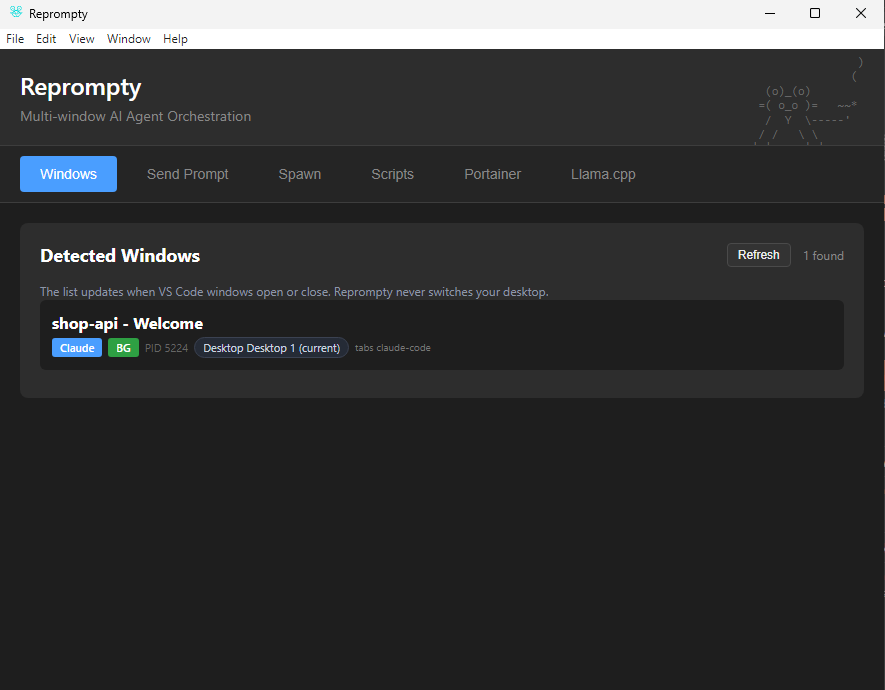

# Reprompty

Reprompty is a desktop app and MCP server for running several AI coding agents at once. It finds your VS Code windows, opens projects on their own virtual desktops and types prompts into Claude Code, Codex, Kilo Code and Kimi Code, without bringing those windows to the front.

Use it from its own window, or connect it to your agents so one agent can open projects and prompt the others. It runs on Windows 11 and KDE Plasma 6 (Linux).



Demo video: <https://www.youtube.com/watch?v=myEoB4hP7Oo>

## What it does

- Lists your open VS Code windows, with the AI agent panel each one has, the virtual desktop it is on, and whether Reprompty can type into it.
- Types a prompt into any of those agent panels and sends it, while you keep working in another window.
- Switches a Claude Code panel to an earlier session first, so the prompt continues the right conversation.
- Opens a project in a new VS Code window on a named virtual desktop, creating the desktop if needed, while you stay on the desktop you are using.
- Moves a VS Code window into a saved layout across your monitors and sets the width of its AI side panel (KDE Plasma).
- Runs your own scripts and turns them into tools your agents can call.
- Gives your AI agents all of this through an MCP server (the standard way coding agents use outside tools), plus a skill that teaches them how to use it.

| | Windows 11 | KDE Plasma 6 |
| --- | --- | --- |
| Find VS Code windows and their agent panels | Yes | Yes |
| Type prompts into Claude Code, Codex, Kilo Code and Kimi Code | Yes | Yes |
| Switch Claude Code sessions | Yes | Yes |
| Open projects on named virtual desktops | Yes | Yes |
| Layouts | Not yet ([roadmap](ROADMAP.md)) | Yes |
| Open a second window on the same project | Not yet | Yes |

Other Linux desktops and macOS are not supported yet.

## Install

You need Git, Node.js 20 or newer, and VS Code with at least one of the Claude Code, Codex, Kilo Code or Kimi Code extensions.

**Windows 11** (PowerShell):

```powershell
winget install --id Git.Git -e
winget install --id OpenJS.NodeJS.LTS -e
```

**KDE Plasma 6** (Arch shown; use your distribution's packages):

```bash
sudo pacman -S --needed git nodejs npm python qt6-tools
yay -S kdotool
```

Then, on both (open a new terminal on Windows so it finds Git and Node):

```bash
git clone https://github.com/topemalheiro/Reprompty.git
cd Reprompty/reprompty
npm install
npm run setup
npm start
```

`npm run setup` connects VS Code and your agents (see the next section). `npm start` builds the app the first time and opens it. Closing the window keeps Reprompty running in the system tray. On KDE Plasma, `npm run setup` also adds Reprompty to your app menu.

After `npm run setup`, quit VS Code completely and open it again, so it picks up the debugging port described below.

## Connect your AI agent

`npm run setup` does everything in one go, for every agent it finds on your computer:

- Turns on VS Code's [debugging port](#vs-codes-debugging-port), which Reprompty uses to type into agent panels.
- Registers Reprompty's MCP server with Claude Code, Codex, Kilo Code and Kimi Code.
- Installs the Reprompty skill, which tells your agent when and how to use the tools.
- On Windows, installs the VirtualDesktop PowerShell module that the desktop features need.

It only changes Reprompty's own entries and keeps a backup of every file it edits (in `~/.reprompty/backups`). To see what it would change first, run `npm run setup -- all --dry-run`. To check everything later, run `npm run setup -- doctor`.

Then reload your agent (for an agent inside VS Code, reload the window) and ask it: "List my VS Code windows with Reprompty."

To connect an agent by hand instead, point it at the MCP server, for example for Claude Code:

```bash
claude mcp add --scope user reprompty -- node /path/to/Reprompty/reprompty/dist/mcp/server.js
```

The server doesn't need the Reprompty app to be open.

## Using the app

**Windows** lists your VS Code windows with their agent panel and desktop. **BG** means Reprompty can type into that window in the background. The list updates by itself when windows open or close.

**Send Prompt**: pick a window, write a prompt and press **Send**. It appears in that window's agent panel without switching to it.

**Spawn** opens a folder in a new VS Code window, optionally on a named desktop. Save the folders you use often under a short name, so you or your agent can open them by that name. **Task presets** save your desktops and project windows so you can reopen them later.

**Scripts**: add your own scripts, run or stop them, start them with Reprompty and see their output.

Extras:

- **Llama.cpp:** start and stop local models with llama.cpp's `llama-server` from saved presets, and open each model's chat page.
- **Portainer:** shows your local Portainer dashboard (`https://localhost:9443`) and starts or stops a Graphiti memory server from its Docker Compose folder.

## Ask your agent

With Reprompty connected, ask in plain words. For example:

- "Open shop-api in a new VS Code window on a desktop called Backend."
- "Tell the Codex window on the Backend desktop to write tests for the checkout module."
- "In the Claude Code window for shop-web, go back to the 'Payment form' session and ask it to finish the validation."
- "Send 'pull main and run the tests' to all my agent windows."
- "Put the shop-api window in layout A." (KDE Plasma)

Every tool and what it needs: [docs/mcp-tools.md](docs/mcp-tools.md).

## Turn your own scripts into tools

In the **Scripts** tab, click **+ Add Script** and choose a script or program. To let your agents run it, add a line like this in a comment within the first 40 lines of the script:

```bash
# reprompty-mcp: {"toolName":"backup_notes","label":"Back up notes","description":"Copy my notes to the backup drive","args":["--once"]}
```

Or click **+ Add MCP tool** on the script's card instead of editing the file. Your agent then sees a `backup_notes` tool that runs the script once with those arguments and returns its output. Restart the agent's MCP server after adding tools. Details: [Tools from your scripts](docs/mcp-tools.md#tools-from-your-scripts).

## Layouts

A layout slot is a window position and size plus the width of the AI side panel. Reprompty starts with two example slots, A and B; set the position and size for your monitors in `~/.reprompty/layouts.json`. Apply a slot by asking your agent, or with Ctrl+Alt+V (slot A) and Ctrl+Alt+N (slot B). On KDE Plasma these are system shortcuts, so they work even when Reprompty is closed: [setting them up](docs/linux-shortcuts.md). Built-in layouts for Windows are on the [roadmap](ROADMAP.md).

## Troubleshooting

**"Electron failed to install correctly"**: run `node node_modules/electron/install.js` in the `reprompty` folder. `npm install` normally does this for you.

**The app quits straight away when started from a VS Code terminal**: start it with `npm start`, which clears the `ELECTRON_RUN_AS_NODE` setting that VS Code terminals sometimes set.

**Your agent doesn't see Reprompty's tools**: run `npm run setup -- doctor`, then reload the agent.

**Desktop features fail on Windows**: the VirtualDesktop PowerShell module is missing. Run `npm run setup` again, or `Install-Module VirtualDesktop -Scope CurrentUser`.

### VS Code's debugging port

Reprompty types into agent panels through VS Code's local debugging port (the Chrome DevTools Protocol). `npm run setup -- cdp` turns it on by adding `"remote-debugging-port": "9222"` to VS Code's `argv.json`. Quit VS Code completely and open it again afterwards. While the port is on, other programs on your computer can control VS Code too.

If a window shows no agent badge or prompts don't arrive, check that the port is on and that the agent's panel is open in that window.

### Logs

The app writes to `reprompty-logs` in your home folder (`%USERPROFILE%\reprompty-logs` on Windows). The MCP server logs to stderr, so its messages show up in your agent's MCP log. Reprompty keeps its settings in `~/.reprompty`.

## How it works

Reprompty is built with Electron, React, TypeScript and Vite. Its MCP server is a separate TypeScript program, bundled with esbuild, that each agent starts on its own; it shares Reprompty's settings files, so the app doesn't need to be open. To type into an agent panel, Reprompty uses VS Code's debugging port. It finds and moves windows with the Win32 API on Windows, and with KWin's D-Bus interface, `kdotool` and a Python layout script on KDE Plasma.

## Roadmap

The full roadmap, with how each item is meant to work, is in [ROADMAP.md](ROADMAP.md). The main things planned:

- **Workspace setup and restore (KDE Plasma):** one agent sets up several KDE Activities, each with its own virtual desktops for agents and tools, and presets bring every window, desktop and Activity back exactly where it was after a reboot.
- **Usage throttle:** a fader that eases your agents off (lower reasoning effort, another model, a pause) before the 5-hour usage limit runs out.
- **Overnight batches with auto shutdown:** give your agents a batch of tasks, leave them running overnight, and Reprompty shuts the computer down when every agent has finished.
- **Master agent mode:** one agent directs the others, waits for them to finish and reads their answers.
- **Files viewer:** every time you prompt an agent again, the files it read or changed open across your displays, so you can follow what it did.
- **Shared chat history between agents**, through Graphiti or another free MCP memory server.
- **Local explainer:** a model on your own computer explains why an agent did what it did.
- **Account switching:** switch between subscriptions or accounts and continue each agent where it was.
- **Windows layouts and one-click installers.**

## License

MIT. See [LICENSE](LICENSE).
